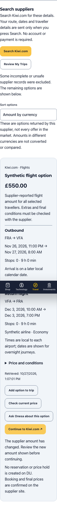

# Travel Southern Africa — implementation and review

Feature branch: `feature/travel-southern-africa`. Release is **not authorized**.
This feature must remain a reviewable draft PR: do not merge or deploy it as part of this task. Draft PRs run the full build/test gate but cannot publish an external Vercel preview.

## Implemented experience

One Travel navigation entry in the existing position; canonical `/travel` landing,
Flights, Stays, Car Hire, Explore and My Trips. Zimbabwe destination cards and
Onesa's Zimbabwe itinerary estimator, AR guide and clearly labelled Sample City
VR demo are retained. The estimator remains an estimate, never a supplier offer.

Shared validated airport identifiers, exact dates, one-way/return flights,
adults, required child ages, rooms, local pickup/drop-off times, EUR/GBP/USD/ZAR.
Airport names identify an airport/nearby planning area, not a provider hotel-city ID.
Room counts require at least one adult per room. Specific room allocations and
property capacity must be confirmed on the provider site. Flights support explicit ±0–3 day flexibility; nearby-airport expansion remains unavailable rather than silently ignored. Hotel eligibility requires an explicit guest nationality; no passport number is collected.

Guest draft uses the existing safe browser storage wrapper and includes a clear-draft action. Travel forms use inline Onesa access so the floating assistant cannot obscure controls. Reviewed searches
and explicitly entered allowances can be collected in a trip. Allowances retain
their currencies with separate subtotals; taxes, baggage, mandatory extras,
insurance excess and deposits remain unknown. No complete trip price is claimed.

Account holders can explicitly save named private trips and searches, list and
restore them, or delete their own records. Server authentication checks both JWT
and current account version. SQL scopes every read/delete by the authenticated
owner. A transaction locks the user row before applying a 30-record quota, so
concurrent requests cannot overfill it. There is no sharing endpoint, public trip
ID or recipient/contact/credential field. Loading a save replaces the browser
draft. Saving never enrolls anybody in marketing or alerts. No production records
have been created by this work.

Successful saved-trip responses are also validated before rendering or restoring
them: record shape, UUIDs, timestamps, draft contents, unique IDs and the
30-record bound. Invalid data shows the recoverable storage error and cannot
replace the guest draft. Chromium and WebKit cover this failure at all three
representative widths.

## Free provider integrations — verified 27 October 2026

The follow-up request explicitly asked for free providers. Two public, read-only
MCP services were found and integrated server-side without accounts, API keys,
subscriptions, payment details, scraping or new dependencies:

| Provider                 | Actual mode and official source                                                                                                                                                                                                                                                                                                                                                                                 | Conditions and limitations                                                                                                                                                                                                                                                                                                                                                                            |
| ------------------------ | --------------------------------------------------------------------------------------------------------------------------------------------------------------------------------------------------------------------------------------------------------------------------------------------------------------------------------------------------------------------------------------------------------------- | ----------------------------------------------------------------------------------------------------------------------------------------------------------------------------------------------------------------------------------------------------------------------------------------------------------------------------------------------------------------------------------------------------- |
| Kiwi.com                 | **Live public flight search**, `https://mcp.kiwi.com`, only `search-flight`. [Official announcement](https://media.kiwi.com/company-news/from-chat-to-boarding-pass-kiwi-com-expands-ai-native-flight-search/), [official installation documentation](https://github.com/alpic-ai/kiwi-mcp-server-public). The live tool schema and read-only responses were inspected.                                         | Public unauthenticated access worked. No billing account or affiliate ID is configured. No published production quota, uptime guarantee or monitoring entitlement was established. Exact airports, one-way/return, passenger age bands, currencies and up to ±3 days are implemented. Self-transfer and airport-change connections are explicitly excluded from requests.                             |
| Pilot                    | **Live public hotel search**, `https://mcp.pilotplans.com/mcp`, only `search_hotels`. [Official documentation](https://mcp.pilotplans.com/).                                                                                                                                                                                                                                                                    | Provider explicitly describes free access without login, key or payment details. Exact dates, adults, rooms, child ages, nationality and requested currency are transferred. The returned amount does **not establish nightly versus full-stay basis**, complete mandatory charges, room allocation or cancellation/payment terms. These remain visibly unconfirmed; no hotel trip total is inferred. |
| OctoTrip                 | [Official free rental-car MCP](https://github.com/OctoTrip/rental-cars) evaluated; **not integrated or enabled**.                                                                                                                                                                                                                                                                                               | Endpoint returned `ua_blocked` and explicitly disallowed this client. No user-agent spoofing, circumvention or repeated blocked searches. Car hire retains the clearly labelled public KAYAK handoff and manual re-entry.                                                                                                                                                                             |
| KAYAK                    | Ordinary public category links retained as a secondary fallback. [Partner links](https://affiliates.kayak.com/deeplinks) require approved portal access.                                                                                                                                                                                                                                                        | No criteria-transfer or affiliate integration is claimed. No fabricated IDs or API access.                                                                                                                                                                                                                                                                                                            |
| Booking.com / Skyscanner | Not added. [Booking MCP](https://developers.booking.com/mcp-server/docs/get-started) requires affiliate ID and Demand API credentials; [Skyscanner API access](https://www.partners.skyscanner.net/contact/travel-api) is reviewed and [widgets](https://skyscannerpartnersupport.zendesk.com/hc/en-us/articles/4666450181149-Getting-Started-How-can-I-get-access-to-Travel-Widgets) require partner approval. | Free signup or a widget advertisement does not supply approved integration access.                                                                                                                                                                                                                                                                                                                    |
| Amadeus / Duffel         | Not selected. [Amadeus official notice](https://developers.amadeus.com/toolbox) says self-service was decommissioned on 17 July 2026. [Duffel pricing](https://duffel.com/pricing) includes excess-search fees above a search-to-book ratio.                                                                                                                                                                    | Old Amadeus free-tier advice is stale. A booking-oriented metered service does not fit DU's free referral-only requirement.                                                                                                                                                                                                                                                                           |

Kiwi is the flight source; Pilot addresses the verified accommodation gap because
Kiwi's public endpoint supplies flights only. Geography is distinct from inventory.
Free public access is not a promise of permanent availability, unrestricted caching,
a production SLA or permission for background monitoring. No automated alerts run.

### Real integration evidence

Nine bounded, read-only searches used synthetic travel criteria for January 2027.
All passed through the actual implemented normalizer and safe-link validation.
No booking, hold, account, email, production data or payment was created.

| Search                                                 | Supplier | Valid observations | Notes                                                                |
| ------------------------------------------------------ | -------- | -----------------: | -------------------------------------------------------------------- |
| FRA–HRE return, 15–22 January                          | Kiwi.com |                  6 | EUR                                                                  |
| JNB–VFA return, 15–22 January                          | Kiwi.com |                 15 | EUR                                                                  |
| CPT–MSU return, 15–22 January                          | Kiwi.com |                  6 | Smaller regional destination                                         |
| LUN–SHO return, 15–22 January                          | Kiwi.com |                  2 | Regional route                                                       |
| Harare stay, 15–22 January                             | Pilot    |                  7 | EUR; pricing basis unconfirmed                                       |
| Cape Town stay, 15–22 January                          | Pilot    |                  7 | EUR; pricing basis unconfirmed                                       |
| JNB–VFA return, ±1 day, mixed adult/child/infant party | Kiwi.com |                 15 | ZAR; South African Airways, Fastjet, Fly Safair and Cem Air appeared |
| JNB–BUQ one-way, 15 January                            | Kiwi.com |                 15 | USD; Fastjet, Airlink and Hahn Air appeared                          |
| Cape Town stay, two adults and child aged 7            | Pilot    |                  6 | GBP; nationality explicitly ZW; pricing basis unconfirmed            |

Observed end-to-end adapter times were **1.1–5.6 seconds**, measured on this Mac.
There is no previous live-search baseline, so no speed improvement is claimed.
These are dated observations, not reusable offers, future coverage guarantees or
production test inventory. Counts/timing only are retained in
[evidence](audits/evidence/travel-provider-searches-2026-10-27.json); raw provider
responses, booking tokens and prices are not committed.

| Country      | Flight evidence                                                 | Stay evidence                   | Car hire    |
| ------------ | --------------------------------------------------------------- | ------------------------------- | ----------- |
| Zimbabwe     | HRE, VFA and BUQ searches returned observations                 | Harare returned observations    | Unavailable |
| South Africa | JNB and CPT regional departures verified                        | Cape Town returned observations | Unavailable |
| Lesotho      | CPT–MSU returned observations                                   | Not live-verified               | Unavailable |
| Eswatini     | LUN–SHO returned observations                                   | Not live-verified               | Unavailable |
| Zambia       | LUN regional departure verified; inbound supply not established | Not live-verified               | Unavailable |
| Botswana     | Not live-verified                                               | Not live-verified               | Unavailable |
| Namibia      | Not live-verified                                               | Not live-verified               | Unavailable |
| Mozambique   | Not live-verified                                               | Not live-verified               | Unavailable |
| Malawi       | Not live-verified                                               | Not live-verified               | Unavailable |
| Angola       | Not live-verified                                               | Not live-verified               | Unavailable |

All ten mainland countries remain searchable starting points; an unverified row
is not a claim of zero inventory. MRU, TNR and SEZ remain extensible location
entries, not verified supplier coverage.

### Trust, failure handling and controls

Searches occur only after an explicit action; nothing is requested while typing.
The UI explains which supplier receives the criteria. Only fixed read-only tools
and endpoints are callable: no generic MCP proxy, booking or feedback tool.
Requests have a 25-second bound, one-MiB response limit, redirect rejection,
two-call concurrency ceiling and no automatic retries. Existing persistent IP
rate limiting applies: 8 searches/rechecks per minute and 100 per day, with the
existing bounded in-memory fallback during database outages. An additional
500-call UTC-day ceiling is per process and resets on process restart; it is not
claimed as a durable fleet-wide quota. No shared provider-response cache or
polling is implemented; API responses are private/no-store.

Responses are validated before use: requested passengers/currency, exact airport
endpoints, requested dates or explicit flexibility, hotel country, local calendar
timestamps and fixed supplier booking-URL allowlists. Unsafe or incomplete items
are omitted while valid items survive; an entirely malformed response is a
failure, not an empty search. Empty results, supplier failures and request limits
have distinct API outcomes. Previous results and the draft survive an outage.
Sorting is by reported amount grouped by currency or total flight duration;
there is no commission ranking or universal cheapest claim.

Up to six selected observations can be retained as alternatives in guest/private
trips. They are separate from manually entered allowances and are never summed
into a fabricated complete trip price. Flight amounts are supplier-reported for
the requested party. Hotel pricing basis, taxes, mandatory fees, deposits and
unsupplied conditions stay unknown. Local airport timestamps are displayed
without converting them into the browser's timezone, including overnight dates.

Snapshots carry a purpose-separated HMAC using the existing server JWT secret.
The private-save endpoint rejects client-altered price/source fields. No new
secret needs provisioning. Historical observations remain history; DU's five-minute
review window is not a supplier price hold or expiry guarantee. Before a booking
link appears, an explicit recheck searches the same criteria and matches the
itinerary/property identity. Changed amounts require review; missing observations
retain the trip and show search-again guidance. Final supplier terms remain
controlling. No availability or quoted price is reserved on DU.

Saved searches strip selected observations and allowances. Saving a full trip
preserves signed observations. The optional Onesa action prepares a human-readable
message in session storage, expires after 15 minutes and is consumed once. It
contains no provider tokens, signatures or travel data in URLs, and does not send
an AI request automatically. The user reviews the message and presses Send;
offline AI leaves the input and trip intact. Supplier information remains
authoritative over AI explanations.

Consent-aware analytics contain fixed event/category names only: criteria review,
successful responses, provider handoffs, saves and returns. No raw destinations,
dates, traveller details or IDs are sent; a handoff is not a conversion.

## Editorial content

Four substantive EN/DE/SN/ND guides, visible review date and canonical anchored
links, explain Zimbabwe routes/baggage, Johannesburg–Victoria Falls, Cape Town
family stays, and airport rental deposits. They are included in static HTML as
well as the rendered UI. Each guide links to a category search and an official
source. Sources were read rather than inferred from their domains:

- [Airlink conditions of carriage, November 2025](https://www.flyairlink.com/sites/default/files/files/4Z-CONDITIONS_of_CARRIAGE.pdf): fare and baggage conditions; no specific allowance claimed.
- [UK government Zimbabwe entry information](https://www.gov.uk/foreign-travel-advice/zimbabwe/entry-requirements): expressly for British passport holders; the guide tells all travellers to confirm their own eligibility rather than repeat a blanket visa rule.
- [Cape Town Tourism TravelWise](https://www.capetown.travel/travelwise/): area and visitor resources; no property availability claim.
- [DiscoverCars rental conditions](https://www.discovercars.com/terms-and-conditions): rental charges versus supplier deposit; terms remain supplier-specific.

A proposed `zimimmigration.gov.zw` source returned unrelated gambling content
when checked. It was excluded. No unstable prices, entry rules or promises of
local expertise have been copied into the guide.

## Route map and hosting

| Previous URL                             | Canonical destination          |
| ---------------------------------------- | ------------------------------ |
| `/tourism`                               | `/travel`                      |
| `/onesa-ai-book-trip`                    | `/travel/planner`              |
| `/onesa-ai-tourism-virtual-experience`   | `/travel/virtual-experience`   |
| `/onesa-ai-tourism-virtual-experince`    | `/travel/virtual-experience`   |
| `/onesa-ai-tourism-augmented-experience` | `/travel/augmented-experience` |
| `/onesa-ai-tourism-augmented-experince`  | `/travel/augmented-experience` |

Each maps directly, including misspellings, `.html` and trailing-slash variants: no chain. Eighteen legacy URL forms are covered. Express and Vite dev/preview
return HTTP 308 and preserve query strings; Vercel declares permanent redirects.
Fragments are retained by browser redirect behavior and client compatibility
routes. Existing destination and Onesa anchors remain in the landing page.

Internal links, search records, Onesa's allowed links, hero preloads, route SEO,
social canonicals, static documents and sitemap use Travel paths. Private trips
are noindex. Category query variants are noindex and canonicalize to the base
category. Existing hreflang was not present, so none has been fabricated. SPA
compatibility aliases remain for hosts with an SPA fallback; native permanent
redirects are the intended production behavior.

## Remaining dependencies (one list)

1. **Car hire:** obtain access to OctoTrip's advertised free endpoint or an approved
   alternative. Do not bypass the explicit client block. Verify regional supply,
   driver age, full rental charge, deposit/excess, fuel/mileage/cross-border terms,
   safe links and revalidation before enabling results. Current manual fallback
   remains usable without suggesting a quote.
2. **Hotel price completeness:** obtain a reliable full-stay/room/occupancy basis,
   mandatory charges and actual room/cancellation/payment conditions from the
   supplier. Pilot's current search does not establish these. Do not multiply an
   ambiguous amount or silently interpret missing fees as zero.
3. **Monitoring:** obtain explicit provider monitoring rights, quotas and delivery
   controls before implementing/enabling background alerts. Current activation
   always returns 503, including consent/recovery-hold cases. No scheduler,
   recipients, alert consent records or messages are created. Future work must
   include thresholds, cadence/expiry, durable deduplication, unsubscribe,
   cancellation, cost caps and recovery holds; it is not enabled by a flag.
4. Review Shona/Ndebele editorial copy with native speakers. Strict automated
   checks establish completeness, not native-language editorial acceptance.
5. Separately authorize merge/release after reviewing the now-expanded PR. Public
   free-provider availability has been verified locally, not from a deployed
   Oracle release. No paid subscriptions, commercial accounts, stock, production
   data, payment integrations or external provider accounts have changed.

## Migration, activation and rollback

After a separately authorized release, standard protected-main CI deploys the
exact tested commit to Oracle and Vercel. Startup adds `travel_saved` with its
owner FK/index, under the existing database initialization lock. It is additive
and restart-safe; no existing table or record is rewritten. Backups include the
new table through the existing whole-database archive process. Verify table and
owned CRUD on an isolated restored database before release; no production
customer should be used as a test account.

Verify direct refresh of all nine new routes, eighteen legacy URL forms with query
and fragment, canonical/static HTML and sitemap, authenticated ownership, and
existing shop/contact/auth/AR/VR behavior in a preview. PR previews intentionally
have no production API access; private saves show the documented failure state.
The feature includes the two public supplier adapters; car hire and alerts remain unavailable. They require further code-reviewed changes, not an arbitrary environment-variable toggle. Existing JWT key rotation also invalidates old snapshot attestations; retain the itinerary and search again rather than weakening verification.

Rollback to the last approved image/frontend release using the existing DU-only
release procedure after owner approval. Keep `travel_saved` intact for recovery;
older code ignores this additive table. Revert the Vercel route configuration
with the frontend commit. No table deletion or data loss is needed. Keep the
existing Oracle backups and deferred independent key-custody decision unchanged.

## Local review

Use Node 22+ and the pinned pnpm version. `pnpm install --frozen-lockfile`, then
`pnpm dev:fast` starts the existing frontend/backend development setup. For a
read-only built UI without configured services, create the existing catalogue
fixture, build with it and run Vite preview:

```sh
node --import tsx scripts/create-catalogue-fixture.mjs /tmp/du-travel-catalogue.json
DU_PUBLIC_CATALOGUE_FILE=/tmp/du-travel-catalogue.json pnpm build
BACKEND_URL=http://127.0.0.1:9 VITE_DEV_HTTPS=false pnpm exec vite preview --config du-platform-frontend/vite.config.ts --host 127.0.0.1 --port 4186 --strictPort
```

Open `http://127.0.0.1:4186/travel`. This Vite-only review has no backend. Guest planning and guides work without services. Public supplier search needs the local Express API but no credentials/database; private saves additionally require authenticated local MySQL. A separate same-origin, localhost-only Express review was started at `http://127.0.0.1:4187/travel` without `.env`, database or background workers; this exposes the two real public search adapters. Do not point either local preview at production. Do not connect a preview to production or treat synthetic catalogue
fixtures as real stock. `pnpm test:e2e:travel` self-starts its own local server;
set `TRAVEL_BROWSER=webkit` for the second browser. UI save-response fixtures are
separate from the actual MySQL HTTP ownership tests.

## Validation results

- Full backend suite: **401 passed, no skips**. Travel coverage is **51 tests**, including **5 actual MySQL HTTP/persistence tests**. The disposable localhost database verified signed-observation persistence, rejected altered prices, owner isolation, quotas and unchanged newsletter/outbox counts. This busy Mac used `--maxWorkers=1 --minWorkers=1 --hookTimeout=120000 --testTimeout=60000`; CI retains its existing default limits and is authoritative for the pushed revision.
- Frontend: **121 Vitest tests + 7 Node checks passed**, including eight saved-response contract cases, three explicit Onesa-handoff tests and canonical Travel links in chat. Private record IDs and travel criteria remain disallowed in chat URLs.
- Type checks, strict EN/DE/SN/ND translations, all guardrails, dependency audit (no known production vulnerabilities), deployment safety tests and build passed. Existing upstream Zod comment-annotation warnings during bundling are non-fatal.
- SEO: **73 route documents / 60 canonical sitemap URLs**; new private trips excluded, all eighteen old URL forms redirect directly, no duplicate Travel aliases in the sitemap.
- Travel journey: **42 checks each in Chromium and WebKit** at **375 / 768 / 1440 px**. Actual loopback HTTP redirects retain query and fragments; forms validate dates/child ages, one-way state survives, three searches collect in a draft, currencies stay separate, public handoff returns safely, guest refresh works, synthetic private save/restore/delete and failure recovery work. Malformed successful saved-trip responses preserve the guest draft and show the recoverable error rather than rendering invalid records. The same journeys verify real-result fixtures, safe handoffs after revalidation, changed-price review, expiry without lost itinerary, partial/failure handling, exact hotel nationality, unknown hotel price basis, source-card contrast and an offline Onesa draft without automatic sending. No page errors in either run.
- Strict responsive/CSP suite: **176 Chromium route checks** across EN/DE/SN/ND at 320/390/768/1440, plus **44 WebKit route checks** (EN at the same widths), with zero CSP violations, runtime errors or unexpected network failures. Travel uses the existing browser-interpreter validation wrapper; no `unsafe-eval` or policy relaxation was added.
- Existing site UI: **122 Chromium checks passed**, covering public/auth/admin views, shop/contact/destination dialogs and keyboard focus. The same **122 checks passed in WebKit**. Additional regressions: **79 discovery checks**, including all four languages and unchanged Home slideshow behavior; **31 offline service/device checks**, including camera/microphone/AI failures, cancellation, no-WebGL fallback and a simulated Quest 3 entering/exiting VR with tracked controllers. No physical headset or production provider was used.
- Build output is **57.92 MiB**, within 60 MiB; no new dependencies, separately deployed services or large destination assets were added. Flights and stays now use live public supplier searches with the limitations above. No measured supplier-price or search-latency improvement is claimed.

Screenshots from the verified local build:




Actual Vite preview verification: **45 checks** covering all eighteen old URL forms, nine canonical pages and their slash/HTML normalization. Global desktop/mobile navigation and query/history recovery passed as well. These are local checks; Vercel's declared production rules cannot be live-verified before a separately authorized release.

PR: [#143](https://github.com/DruHustle/du-platform/pull/143). Its full normal CI gate runs on every pushed commit; preview and production deploy jobs are excluded for this draft. The PR checks are authoritative for the final pushed revision.

Live supplier integration is locally verified as documented above. No production deployment is claimed.
