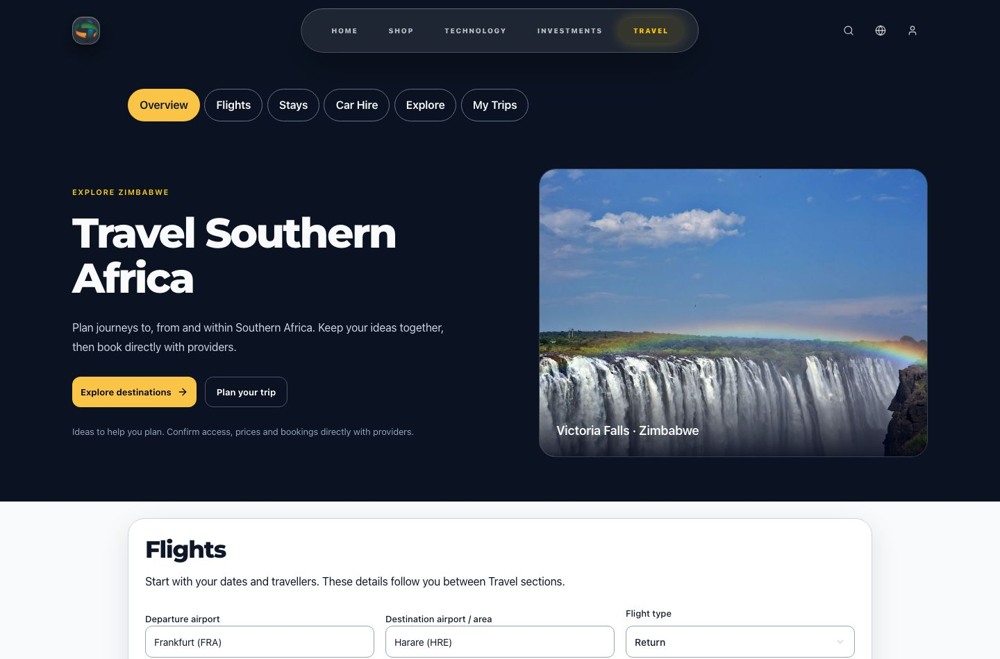
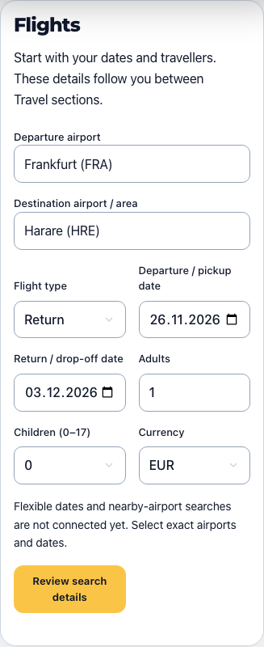
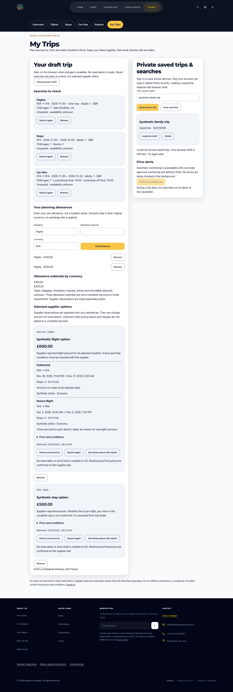

# Travel Southern Africa — implementation and review

Feature branch: `feature/travel-southern-africa`. Release is **not authorized**.
This feature must remain a reviewable draft PR: do not merge or deploy it as part of this task. Draft PRs run the full build/test gate but cannot publish an external Vercel preview.

## What works without provider access

One Travel navigation entry in the existing position; canonical `/travel` landing,
Flights, Stays, Car Hire, Explore and My Trips. Zimbabwe destination cards and
Onesa's Zimbabwe itinerary estimator, AR guide and clearly labelled Sample City
VR demo are retained. The estimator remains an estimate, never a supplier offer.

Shared validated airport identifiers, exact dates, one-way/return flights,
adults, required child ages, rooms, local pickup/drop-off times, EUR/GBP/USD/ZAR.
Airport names identify an airport/nearby planning area, not a provider hotel-city ID.
Room counts require at least one adult per room. Specific room allocations and
property capacity must be confirmed on the provider site. Flexible dates and
nearby-airport searches remain unavailable rather than ignored provider options.

Guest draft uses the existing safe browser storage wrapper and includes a clear-draft action. Travel forms use inline Onesa access so the floating assistant cannot obscure controls. Reviewed searches
and explicitly entered allowances can be collected in a trip. Allowances retain
their currencies with separate subtotals; taxes, baggage, mandatory extras,
insurance excess and deposits remain unknown. No complete trip price is claimed.

Account holders can explicitly save named private trips and searches, list and
restore them, or delete their own records. Server authentication checks both JWT
and current account version. SQL scopes every read/delete by the authenticated
owner. A transaction locks the user row before applying a 30-record quota, so
concurrent requests cannot overfill it. There is no sharing endpoint, public trip
ID or recipient/contact/credential field. Loading a save replaces the browser
draft. Saving never enrolls anybody in marketing or alerts. No production records
have been created by this work.

## Provider evaluation — reviewed 27 October 2026

Local and Oracle configuration were checked for provider variable names only:
no KAYAK, Booking, Skyscanner, DiscoverCars or travel-provider configuration was
present. No secrets were printed. Absence of configuration is not account approval.

| Candidate                        | Official evidence and access                                                                                                                                                                                                                                                                                                | Cost, attribution and caching                                                                                                                                 | Actual feature mode                                                                                                             |
| -------------------------------- | --------------------------------------------------------------------------------------------------------------------------------------------------------------------------------------------------------------------------------------------------------------------------------------------------------------------------- | ------------------------------------------------------------------------------------------------------------------------------------------------------------- | ------------------------------------------------------------------------------------------------------------------------------- |
| KAYAK, preferred first candidate | [Network](https://affiliates.kayak.com/), [APIs](https://affiliates.kayak.com/apis), [deeplinks](https://affiliates.kayak.com/deeplinks): approval and portal-generated links; sandbox request offered. Flights, hotels and cars are advertised, but DU regional supply is unverified.                                      | Production price, quotas, caching and monitoring rights require a written partner agreement. Preserve prescribed attribution; no assumed free production API. | **Unavailable API/embed/criteria links.** Ordinary public category links only, without attribution IDs or transferred criteria. |
| Booking.com                      | [Affiliate programme](https://www.booking.com/affiliate-program/v2/index.html) offers links via affiliate networks; [Demand prerequisites](https://developers.booking.com/demand/docs/getting-started/prerequisites) require managed-partner registration, signed contract, account-manager access, token and affiliate ID. | Affiliate signup is advertised free; API access, commercial terms, redistribution, caching and monitoring need the managed agreement.                         | Unavailable; not added as a second integration.                                                                                 |
| DiscoverCars                     | [Affiliate programme](https://www.discovercars.com/affiliate) offers text links/widgets and free signup. This does not establish API entitlement or regional inventory.                                                                                                                                                     | Commission model; approved creatives, API/cache/monitoring conditions and quotas require agreement.                                                           | Unavailable; no unverified affiliate ID or widget.                                                                              |
| Skyscanner                       | [Affiliate programme](https://www.partners.skyscanner.net/product/affiliates) offers reviewed applications, widgets and links; published criteria include over 5,000 unique monthly visitors. Affiliate access is not API access.                                                                                           | Performance-based commercial terms and tracking; API, cache and monitoring permissions not established for DU.                                                | Unavailable.                                                                                                                    |

All production capability switches are explicitly false, not inferred from an
API key or arbitrary environment flag. A search submission **reviews criteria**;
it never pretends to have searched suppliers. The external action says it opens
a public KAYAK search, requires re-entry of criteria and is not an affiliate
integration. The search brief can be copied; the draft survives the handoff.
No remote requests occur on typing, no supplier polling, no API cost, no cache,
no fictitious offers, no price sorting or payout ranking. Outbound resource clicks
are not counted as conversions. Consent-aware fixed analytics events contain no
locations, dates, account IDs or raw search criteria. There is no results-success
event while no supplier results exist.

### Geographic scope and evidence

| Country      | Curated airport starting points | Flights                  | Stays                    | Cars                     |
| ------------ | ------------------------------- | ------------------------ | ------------------------ | ------------------------ |
| Zimbabwe     | HRE, VFA, BUQ                   | Unverified / unavailable | Unverified / unavailable | Unverified / unavailable |
| South Africa | JNB, CPT, DUR                   | Unverified / unavailable | Unverified / unavailable | Unverified / unavailable |
| Botswana     | GBE, MUB                        | Unverified / unavailable | Unverified / unavailable | Unverified / unavailable |
| Namibia      | WDH                             | Unverified / unavailable | Unverified / unavailable | Unverified / unavailable |
| Zambia       | LUN, LVI                        | Unverified / unavailable | Unverified / unavailable | Unverified / unavailable |
| Mozambique   | MPM, VNX                        | Unverified / unavailable | Unverified / unavailable | Unverified / unavailable |
| Malawi       | LLW, BLZ                        | Unverified / unavailable | Unverified / unavailable | Unverified / unavailable |
| Lesotho      | MSU                             | Unverified / unavailable | Unverified / unavailable | Unverified / unavailable |
| Eswatini     | SHO                             | Unverified / unavailable | Unverified / unavailable | Unverified / unavailable |
| Angola       | LAD                             | Unverified / unavailable | Unverified / unavailable | Unverified / unavailable |

Location entries are extensible (MRU, TNR, SEZ already included), not inventory.
Automated synthetic validation covers FRA–HRE, JNB–VFA, JNB–BUQ, CPT–MSU and
LUN–SHO. **These are validation tests, not supplier searches.** No airline,
country or category is declared supported by a live provider. After approval,
verify representative international, regional and smaller-airport supply and
operating airlines, empty/failure outcomes and complete occupancy before changing
this table. No bookings may be created during these checks.

## Editorial content

Four substantive EN/DE/SN/ND guides, visible review date and canonical anchored
links, explain Zimbabwe routes/baggage, Johannesburg–Victoria Falls, Cape Town
family stays, and airport rental deposits. They are included in static HTML as
well as the rendered UI. Each guide links to a category search and an official
source. Sources were read rather than inferred from their domains:

- [Airlink conditions of carriage, November 2025](https://www.flyairlink.com/sites/default/files/files/4Z-CONDITIONS_of_CARRIAGE.pdf): fare and baggage conditions; no specific allowance claimed.
- [UK government Zimbabwe entry information](https://www.gov.uk/foreign-travel-advice/zimbabwe/entry-requirements): expressly for British passport holders; the guide tells all travellers to confirm their own eligibility rather than repeat a blanket visa rule.
- [Cape Town Tourism TravelWise](https://www.capetown.travel/travelwise/): area and visitor resources; no property availability claim.
- [DiscoverCars rental conditions](https://www.discovercars.com/terms-and-conditions): rental charges versus supplier deposit; terms remain supplier-specific.

A proposed `zimimmigration.gov.zw` source returned unrelated gambling content
when checked. It was excluded. No unstable prices, entry rules or promises of
local expertise have been copied into the guide.

## Route map and hosting

| Previous URL                             | Canonical destination          |
| ---------------------------------------- | ------------------------------ |
| `/tourism`                               | `/travel`                      |
| `/onesa-ai-book-trip`                    | `/travel/planner`              |
| `/onesa-ai-tourism-virtual-experience`   | `/travel/virtual-experience`   |
| `/onesa-ai-tourism-virtual-experince`    | `/travel/virtual-experience`   |
| `/onesa-ai-tourism-augmented-experience` | `/travel/augmented-experience` |
| `/onesa-ai-tourism-augmented-experince`  | `/travel/augmented-experience` |

Each maps directly, including misspellings, `.html` and trailing-slash variants: no chain. Eighteen legacy URL forms are covered. Express and Vite dev/preview
return HTTP 308 and preserve query strings; Vercel declares permanent redirects.
Fragments are retained by browser redirect behavior and client compatibility
routes. Existing destination and Onesa anchors remain in the landing page.

Internal links, search records, Onesa's allowed links, hero preloads, route SEO,
social canonicals, static documents and sitemap use Travel paths. Private trips
are noindex. Category query variants are noindex and canonicalize to the base
category. Existing hreflang was not present, so none has been fabricated. SPA
compatibility aliases remain for hosts with an SPA fallback; native permanent
redirects are the intended production behavior.

## Owner dependency checklist (one list)

1. Approve a provider application; KAYAK is the preferred initial candidate,
   not a selected/approved business relationship. Obtain approved production and
   sandbox access, exact documentation/version, API and criteria-link templates,
   location identifiers and the approved DU domain.
2. Obtain written per-category/country coverage, attribution, permitted storage
   and cache TTL, redistribution rights, monitoring permission, commercial price,
   request/concurrency quotas, daily cost cap and cancellation terms. Do not
   subscribe or register an external account without owner authorization.
3. Put approved credentials in server-side secret storage only. Implement and
   test an adapter against the approved contract before changing capability
   flags. Include complete total/fees/occupancy, local flight dates and overnight
   arrival, baggage/self-transfer, cancellations, car deposits/excess/fuel/mileage,
   unknown conditions, stable offer IDs, retrieval/expiry and safe provider links.
   Require revalidation/search-again without discarding selected itinerary data.
   No approved contract exists yet, so inventing an adapter would be misleading.
4. Before alerts can activate, agree exact criteria, threshold and currency,
   opt-in/unsubscribe, cadence/expiry, unique observation/delivery keys, per-user
   and global limits, daily budget, provider permission and recovery hold. Reuse
   the transactional durable outbox only after that contract exists; cancellation
   must invalidate pending work and restore must keep outbound delivery paused.
   Alert activation currently returns 503 for every request, including explicit
   consent and recovery holds. No alert recipients, scheduler or deliveries exist.
5. Review translated editorial copy with native Shona/Ndebele speakers. Strict
   automated checks verify completeness, not native-language editorial quality.
6. Review this PR and explicitly authorize merge/release separately. No provider
   account, subscription, booking, stock, commerce mode or production data is changed.

## Migration, activation and rollback

After a separately authorized release, standard protected-main CI deploys the
exact tested commit to Oracle and Vercel. Startup adds `travel_saved` with its
owner FK/index, under the existing database initialization lock. It is additive
and restart-safe; no existing table or record is rewritten. Backups include the
new table through the existing whole-database archive process. Verify table and
owned CRUD on an isolated restored database before release; no production
customer should be used as a test account.

Verify direct refresh of all nine new routes, eighteen legacy URL forms with query
and fragment, canonical/static HTML and sitemap, authenticated ownership, and
existing shop/contact/auth/AR/VR behavior in a preview. PR previews intentionally
have no production API access; private saves show the documented failure state.
Enabling supplier results or alerts is a further code-reviewed release, not an
environment-variable toggle on this implementation.

Rollback to the last approved image/frontend release using the existing DU-only
release procedure after owner approval. Keep `travel_saved` intact for recovery;
older code ignores this additive table. Revert the Vercel route configuration
with the frontend commit. No table deletion or data loss is needed. Keep the
existing Oracle backups and deferred independent key-custody decision unchanged.

## Local review

Use Node 22+ and the pinned pnpm version. `pnpm install --frozen-lockfile`, then
`pnpm dev:fast` starts the existing frontend/backend development setup. For a
read-only built UI without configured services, create the existing catalogue
fixture, build with it and run Vite preview:

```sh
node --import tsx scripts/create-catalogue-fixture.mjs /tmp/du-travel-catalogue.json
DU_PUBLIC_CATALOGUE_FILE=/tmp/du-travel-catalogue.json pnpm build
BACKEND_URL=http://127.0.0.1:9 VITE_DEV_HTTPS=false pnpm exec vite preview --config du-platform-frontend/vite.config.ts --host 127.0.0.1 --port 4186 --strictPort
```

Open `http://127.0.0.1:4186/travel`. Guest planning and guides work without a
provider or database. Private saves require the local authenticated backend and
MySQL. Do not connect a preview to production or treat synthetic catalogue
fixtures as real stock. `pnpm test:e2e:travel` self-starts its own local server;
set `TRAVEL_BROWSER=webkit` for the second browser. UI save-response fixtures are
separate from the actual MySQL HTTP ownership tests.

## Validation results

- Full backend suite: **376 passed, no skips**. Final Travel-only coverage, including independent categories and same-day date/time validation: **28 tests**, including **4 actual MySQL HTTP/persistence tests**. The busy Mac required `--maxWorkers=1 --minWorkers=1 --hookTimeout=120000 --testTimeout=60000` for database setup and filesystem latency; assertions were unchanged. Earlier default-timeout attempts failed locally and are not reported as passes. CI retains its existing default limits.
- Frontend: **111 Vitest tests + 7 Node checks passed**.
- Type checks, strict EN/DE/SN/ND translations, all guardrails, dependency audit (no known production vulnerabilities), deployment safety tests and build passed. Existing upstream Zod comment-annotation warnings during bundling are non-fatal.
- SEO: **73 route documents / 60 canonical sitemap URLs**; new private trips excluded, all eighteen old URL forms redirect directly, no duplicate Travel aliases in the sitemap.
- Travel journey: **24 checks each in Chromium and WebKit** at **375 / 768 / 1440 px**. Actual loopback HTTP redirects retain query and fragments; forms validate dates/child ages, one-way state survives, three searches collect in a draft, currencies stay separate, public handoff returns safely, guest refresh works, synthetic private save/restore/delete and failure recovery work. No page errors in either run.
- Strict responsive/CSP suite: **176 Chromium route checks** across EN/DE/SN/ND at 320/390/768/1440, plus **44 WebKit route checks** (EN at the same widths), with zero CSP violations, runtime errors or unexpected network failures. Travel uses the existing browser-interpreter validation wrapper; no `unsafe-eval` or policy relaxation was added.
- Existing site UI: **122 Chromium checks passed**, covering public/auth/admin views, shop/contact/destination dialogs and keyboard focus. The same **122 checks passed in WebKit**. Additional regressions: **79 discovery checks**, including all four languages and unchanged Home slideshow behavior; **31 offline service/device checks**, including camera/microphone/AI failures, cancellation, no-WebGL fallback and a simulated Quest 3 entering/exiting VR with tracked controllers. No physical headset or production provider was used.
- Build output remains within 60 MiB; no additional network services, packages or large destination assets were added. This is a planning/referral foundation, **not live comparison**. No measured supplier-price or search-latency improvement is claimed.

Screenshots from the verified local build:





Actual Vite preview verification: **45 checks** covering all eighteen old URL forms, nine canonical pages and their slash/HTML normalization. Global desktop/mobile navigation and query/history recovery passed as well. These are local checks; Vercel's declared production rules cannot be live-verified before a separately authorized release.

PR: [#143](https://github.com/DruHustle/du-platform/pull/143). Its full normal CI gate runs on every pushed commit; preview and production deploy jobs are excluded for this draft. The PR checks are authoritative for the final pushed revision.

No production deployment or live supplier integration is claimed.
